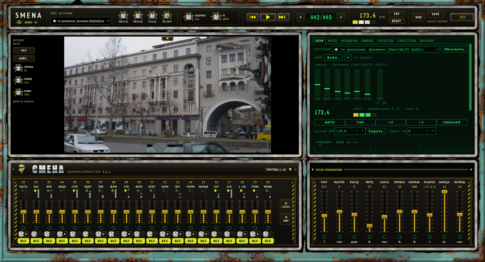

# SMENA

*a field report, filed at 4 a.m., from somewhere between the speaker cone and the projector lamp*

It started, as these things do, with a folder of photographs and a track that would not stop.
Fifty-six frames from a trip nobody fully remembers. A bassline the size of a freight elevator.
And a tin box — turquoise, rusted at the seams, a yellow eye bolted to the front — that claimed it
could make the two of them talk.

We did not ask how. You don't ask a machine like that how. You plug it in, you put the needle down,
and you watch what it does to the room.

## What happens when you switch it on

Hard to say. Harder to explain to the landlord.

The box **listens**. Not politely — it eavesdrops on whatever your computer is playing: a player,
Traktor, Reaper, a sound card input, a cable from the mixer. Twenty separate nerves twitch inside it —
kick, bass, brightness, accents, stereo, hats, rumble, the long slow breath before a drop — and each one
wants something from your pictures.

The pictures **come apart**. Trees, cars, balconies, the kid on the bicycle — pried loose from their
backgrounds by a neural network with a surgeon's patience, while a second network quietly paints over
the holes as if nothing had ever stood there. All on your own machine. Nothing leaves the building.
Nobody in a data center gets to see your holiday.

Then the pieces **move**. When, where, and why is between the box, the beat and you.
We have theories. None of them hold up in daylight.

## The controls, such as they are

- **Twenty trigger channels** — ON, STRENGTH, SENSITIVITY each, a yellow fader bank that looks
  borrowed from a Soviet oscilloscope and behaves like it has opinions.
- **A control bay** — past, master, dropout, glide, slowdown, period. Do not touch PERIOD after midnight.
- **Four LFOs with patch cables.** Drag a wire from any oscillator to any fader. The scope shows you the
  wave. It does not show you the consequences.
- **Presets** — *slow*, *medium*, *trance*. Pick one according to how the night is going.
- **REC** — one button, a lamp, and whatever just happened is an MP4 in `Movies/SMENA`. Evidence.
- **OUTPUT** — a borderless window for the projector, a warp grid and a mask for crooked walls,
  BLACKOUT for when the police arrive.
- **The shutter** at the top hides the manual. Pull it.

## The editor, and the thing that learns

Sooner or later the networks will cut out something you didn't want — a lamppost instead of the
woman under it, the sky instead of the bird. That's when you open the **Element Editor**.

Click to keep. Click to throw away. Click once on anything in the frame and SAM 2 draws its outline
for you. Points, eraser, shapes, rotate the photo, fix a crooked horizon — then press **B** and the
elements are rebuilt.

Every decision you make is written down. Mark enough of them and press **Train model**: SMENA
studies your taste and, next time, picks the pieces the way *you* would. Tick the box on the PHOTOS
tab and the model takes over from the default rules for every new set you feed it. The more you
argue with it, the more it starts to sound like you. This is either a feature or the beginning of a
very strange relationship.

## Getting the thing

**[→ Latest release](../../releases/latest)**

| | File | Neural networks inside | You need |
|---|---|---|---|
| **Windows** | `SMENA_Setup-x.y.z.exe` (~100 MB) | no — point the PHOTOS tab at a Python that has them (see below) | Windows 10/11 x64, any OpenGL 3.3 GPU |
| **macOS** | `SMENA-x.y.z-mac-arm64.dmg` (~760 MB) | yes — SAM 2 + LaMa on Metal | macOS 13+, Apple Silicon M1–M4, 8 GB RAM (16 is kinder) |

Three photographs of Tbilisi concrete (CC0, from Wikimedia Commons) ship inside, so the box has
something to chew on the first time.

**macOS, first night.** The app isn't signed by Apple, so macOS will refuse it once, on principle.
- macOS 15+: open SMENA → *Done* → *System Settings → Privacy & Security* → **Open Anyway**.
- macOS 13–14: right-click SMENA → *Open* → *Open*.
- Any version: `xattr -dr com.apple.quarantine /Applications/SMENA.app`

To let it hear the rest of your Mac, install [BlackHole 2ch](https://existential.audio/blackhole/) and
route output through a Multi-Output Device. SMENA finds it on its own. Allow the microphone when asked.

**Windows.** SmartScreen will mutter about an unknown publisher → *More info* → *Run anyway*.
The installer hands SMENA the discrete GPU so the visuals don't end up on the integrated chip.

## From source, for the reckless

Python 3.12.

    python -m venv .venv-smena
    .venv-smena/bin/pip install -r requirements-smena.txt     # Windows: .venv-smena\Scripts\pip
    .venv-smena/bin/python -m smena                           # or: python -m smena --selftest

Photo preparation needs PyTorch, SAM 2 and LaMa in a separate `.venv-prep` — see
[docs/SETUP.md](docs/SETUP.md); models: `python tools/build/fetch_models.py`.
Installers: `pyinstaller packaging/smena.spec` (`SMENA_NN=1` to pack the networks), then
`python tools/build/package.py`. GitHub Actions does both on every `v*` tag.

## Paperwork

Code — [MIT](LICENSE). Artwork — the tin, the eye, the icons — [CC BY-NC 4.0](LICENSE-ART.md).
Demo photos CC0, fonts OFL, models Apache 2.0: [CREDITS.md](CREDITS.md).

*© 2026 Unknown_Tone. No photographs were harmed. Several were taken apart.*
