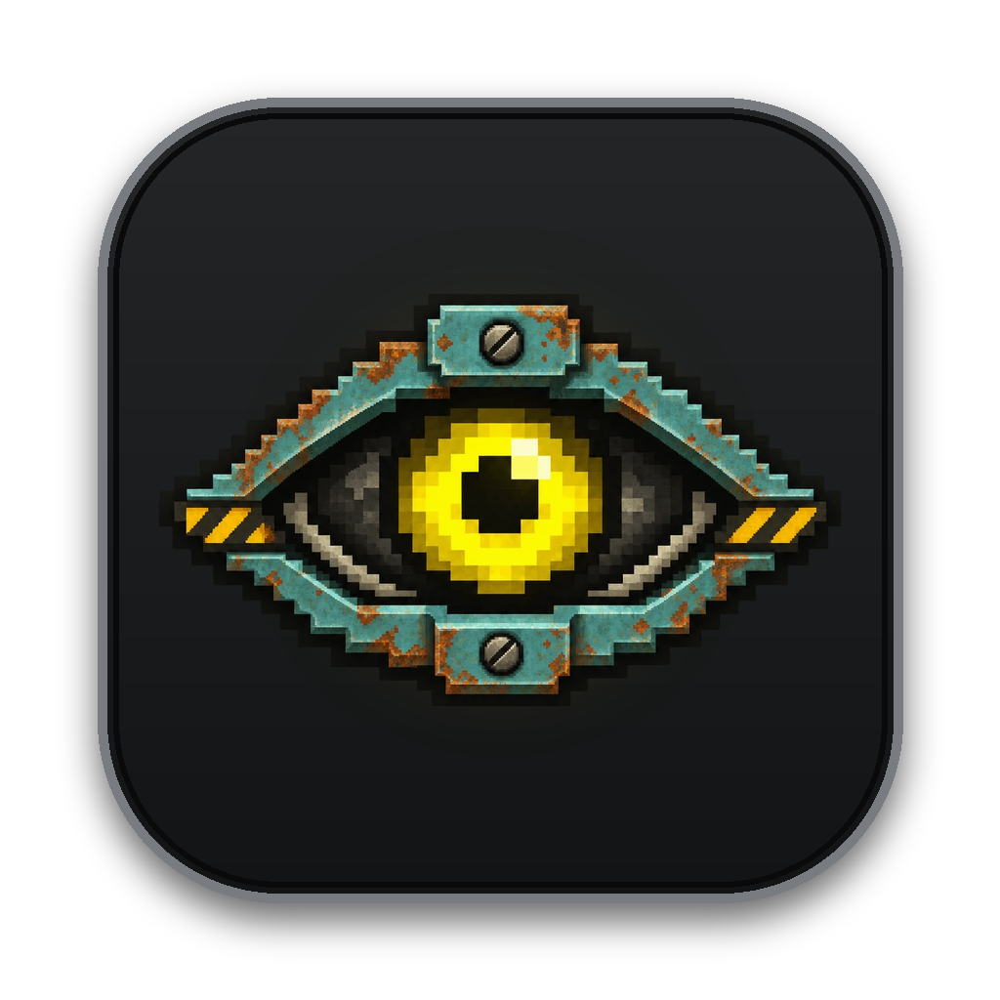

<p align="center"></p>

# SMENA — photo VJ

**SMENA** listens to the music playing on your computer and builds live visuals in real time from **pieces of your
photos**: elements slide in from the edges, their contents move in strips, backgrounds change on the strong beat.
Twenty audio triggers, a fader bank, LFOs with patch cables, recording to MP4, an output window for a projector.
Neural networks (SAM 2 + LaMa) cut any photo set into elements — locally, nothing leaves your machine.

**SMENA** слушает музыку, которая играет на компьютере, и в реальном времени собирает визуал из **элементов ваших
фотографий**: элементы въезжают от краёв, содержимое движется полосами, фон меняется на сильную долю. 20 триггеров
по звуку, фейдербанк, LFO с проводами, запись в MP4, окно вывода на проектор. Нейросети (SAM 2 + LaMa) режут любой
набор фото на элементы — локально, фото никуда не уходят.


## Download / Скачать

[**Releases**](../../releases/latest)

| | File | Neural networks | Requirements |
|---|---|---|---|
| **Windows** | `SMENA_Setup-x.y.z.exe` (~100 MB) | not included — point the ФОТО tab to a Python with them (`.venv-prep`, below) | Windows 10/11 x64, OpenGL 3.3 GPU |
| **macOS** | `SMENA-x.y.z-mac-arm64.dmg` (~1.3 GB) | SAM 2 + LaMa inside (Metal) | macOS 13+, Apple Silicon (M1–M4), 8 GB RAM (16 recommended) |

A demo set of three photos (CC0, Tbilisi architecture) is built in. / Демо-набор из трёх фото встроен.

**macOS, first launch:** the app is not signed — right-click → *Open*; see `README — first launch.txt` in the
disk image. System audio needs [BlackHole 2ch](https://existential.audio/blackhole/) (or pick an audio input).
**macOS, первый запуск:** правый клик → «Открыть»; звук системы — через BlackHole 2ch (или выберите вход карты).

**Windows:** SmartScreen may warn about an unknown publisher → *More info* → *Run anyway*. The installer
assigns the discrete GPU (NVIDIA/AMD) to SMENA. / SmartScreen: «Подробнее» → «Выполнить в любом случае».

## Quick start / Быстрый старт

1. Play music in any player. SMENA listens to the default output (Windows loopback / BlackHole on Mac).
   Or **ЗВУК → Файл…** — SMENA plays and analyses a track itself.
2. **ФОТО → Выбрать…** — a folder of photos (order — by the number at the start of the file name).
3. **Подготовить фото** — SAM 2 → element selection → LaMa, in the background.
4. Faders, presets (slow / medium / trance), **REC** → `Movies/SMENA`, **ВЫВОД** → projector window, mapping grid.

The full manual opens from the shutter at the top of the window (`docs/manual/smena_manual.html`).
Руководство — шторка сверху окна.

## Run from source / Запуск из исходников

Python 3.12.

```bash
python -m venv .venv-smena
.venv-smena/bin/pip install -r requirements-smena.txt        # Windows: .venv-smena\Scripts\pip
.venv-smena/bin/python -m smena                              # self-check: python -m smena --selftest
```

Photo preparation (neural networks) uses a separate environment `.venv-prep` with PyTorch — see
[docs/SETUP.md](docs/SETUP.md); models: `python tools/build/fetch_models.py`.
The app finds `.venv-prep` next to the sources automatically.

Build installers: `pyinstaller packaging/smena.spec` (`SMENA_NN=1` — with neural networks), then
`python tools/build/package.py`. GitHub Actions does both for every `v*` tag (`.github/workflows/build.yml`).

## Docs / Документы (RU)

| | |
|---|---|
| [docs/SPEC.md](docs/SPEC.md) | the algorithm / алгоритм (главный документ) |
| [docs/build/](docs/build/00_START_HERE.md) | program spec / ТЗ на программу |
| [docs/SETUP.md](docs/SETUP.md) | environments / окружения |

## License / Лицензия

Code — [MIT](LICENSE). Artwork (textures, eye logo, icons, design) — [CC BY-NC 4.0](LICENSE-ART.md).
Demo photos — CC0, fonts — OFL, models — Apache 2.0: see [CREDITS.md](CREDITS.md).
